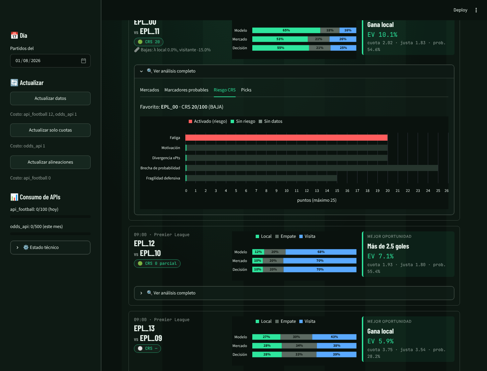
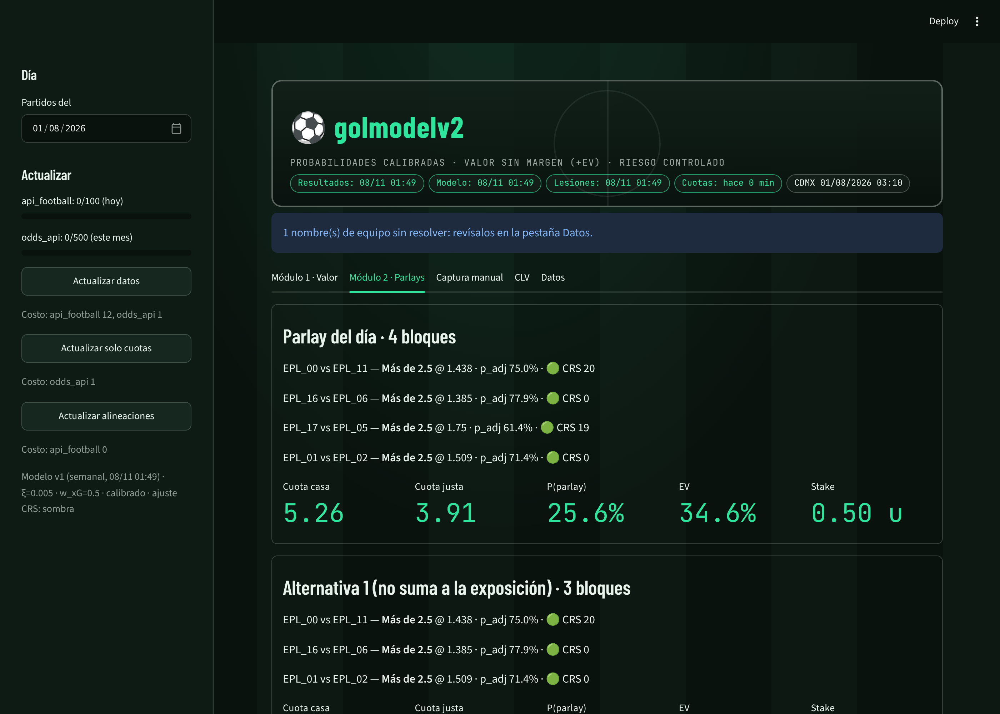

# ⚽ golmodelv2

**Probabilidades calibradas · valor sin margen (+EV) · riesgo controlado.**

Aplicación analítica para apuestas de fútbol (12 ligas: Premier, La Liga, Serie A, Bundesliga, Ligue 1, Liga MX, Liga MX Femenil, MLS, Brasileirão, Eredivisie, Bélgica y Portugal). Prioriza tres cosas: que las probabilidades estén bien calibradas, que el valor esperado se mida después de quitar el margen de la casa y que la gestión de riesgo sea conservadora. Todo el stack de esta versión es gratuito.



## Qué hace
| Componente | Método |
|---|---|
| Marcadores | Dixon-Coles (1997) con decaimiento exp(−ξt), xG como insumo (w_xG), pooling parcial por liga y prior suave sobre ρ |
| Mercado | Margen quitado con Shin (1993) o potencia; p_adj = α·p_modelo + (1−α)·p_mercado, con α calibrado en walk-forward |
| Diario y Qué meter | Tarjeta por partido (gana, primer gol, el otro anota, forma) y jugadas del día con **cuota mínima**, partidos que rompen parlays y parlays por perfil |
| Módulo 1 | 1X2, doble oportunidad, BTTS, O/U 1.5/2.5/3.5, equipo anota y hándicap asiático ±1.0/±1.5 (con push), todos desde la matriz |
| Módulo 2 | Parlays de 3 a 5 bloques; los SGP se calculan sumando celdas de la matriz (nunca multiplicando) y se ordenan por crecimiento logarítmico (Kelly) |
| Tickets 5 equipos | Las combinaciones más probables que pagan ≈15-30x, con razones por pierna (modelo vs mercado, CRS) y «1 de cada N» |
| CRS | Casinazo Risk Score: veto a las selecciones del favorito en riesgo; el ajuste de probabilidad queda en modo sombra hasta validarlo |
| Banca | Kelly fraccional (0.25 en simples, 0.10 en parlays), topes de 2u / 0.5u y exposición diaria de 5u |
| Córners y jugadores | Córners con Binomial Negativa (estilo de equipo, rival y árbitro); anota y tiros al arco desde xG/90, titularidad y rival |
| SGP correlacionado | Simulación conjunta goles + córners + jugadores con cópula y reparto estructural de goles (`dependencia_mercados.py`) |
| Soñadoras analíticas | El ticket más probable dentro de un rango de cuota, etiquetado «De Valor (+EV)» o «Entretenimiento» |
| NFL | Paquete aparte (`motor_nfl/`): Elo + EPA con Normal; moneyline, spread y totales con push |
| Validación | Walk-forward estricto, log-loss, Brier, calibración, CLV y regla de 300 partidos antes de usar dinero real |



## Arranque rápido
```bash
cp .env.example .env
```
```bash
docker compose up -d --build
```
```bash
docker compose run --rm api python scripts/cargar_historico.py --temporadas 5
```
Después de cargar el histórico, la UI queda en http://localhost:8501 y la API en http://localhost:8000/docs.

**Desde el celular sin tu Mac:** `render.yaml` + [`docs/operacion.md` §14](docs/operacion.md).

Guía completa: [`docs/operacion.md`](docs/operacion.md). Decisiones de diseño: [`docs/decisiones.md`](docs/decisiones.md), [`docs/proveedores.md`](docs/proveedores.md) y [`docs/modulo2_pseudocodigo.md`](docs/modulo2_pseudocodigo.md).

## Pruebas
```bash
pytest
```
Corre más de 1,000 pruebas. Las de integración contra PostgreSQL se omiten si no está disponible.

```bash
psql -f db/tests/test_schema.sql
```
Corre las pruebas del esquema (inmutabilidad, anti look-ahead y veto CRS).

> ⚠️ Herramienta analítica, no consejo de inversión. No se apuesta dinero real hasta tener CLV positivo con significancia estadística en paper trading.
